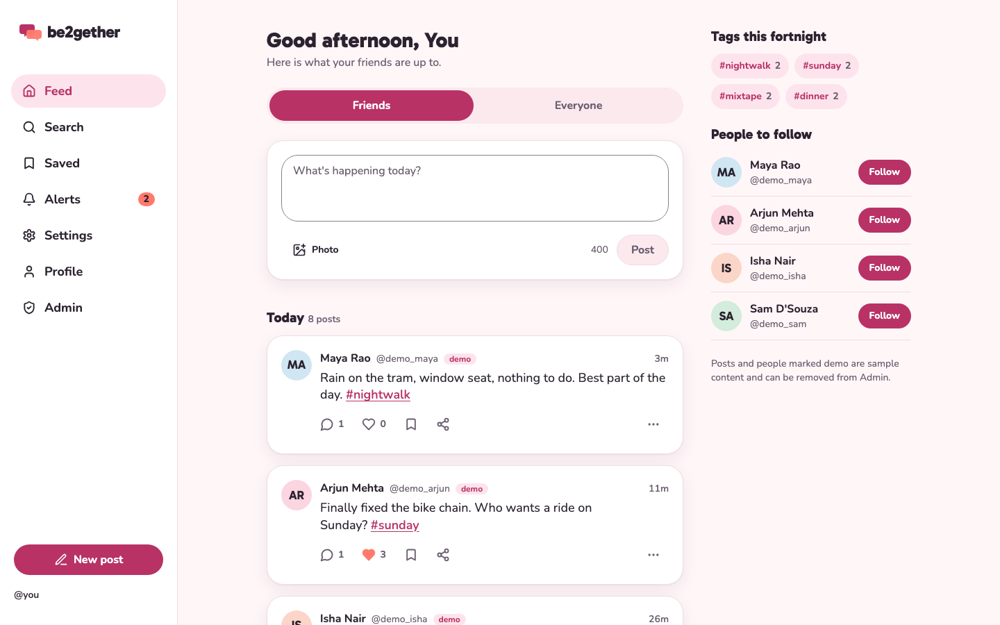
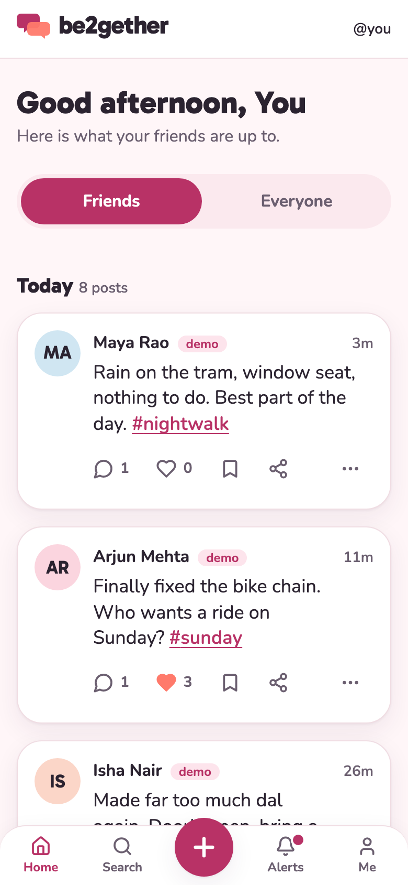
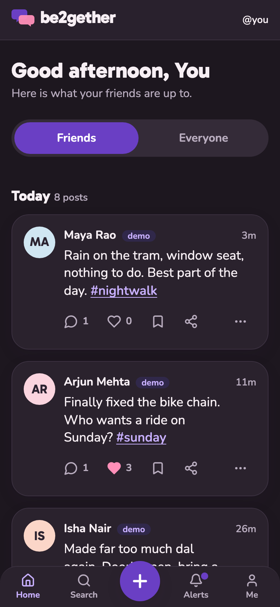

# be2gether

A friendly daily feed for friends. Share a post (text and an optional photo), reply, like, save, share a link and follow. Friends and Everyone tabs, a warm and soft look, and a Settings page for colour themes, animations and reading comfort.



<p>
  
  
</p>

_Screenshots use synthetic demo content from `scripts/mock-api.ts`, not real people or posts._

Built with Next.js 15, React 19, Tailwind 4, Clerk, Prisma + PostgreSQL, UploadThing and Zustand.

## Run it

```bash
npm install
cp .env.example .env   # then fill it in
npx prisma db push     # additive: adds Bookmark, Report, isDemo columns
npm run dev
```

### Environment

| Variable | Purpose |
| --- | --- |
| `DATABASE_URL` | PostgreSQL connection string |
| `NEXT_PUBLIC_CLERK_PUBLISHABLE_KEY`, `CLERK_SECRET_KEY` | Clerk auth |
| `UPLOADTHING_TOKEN` | Photo uploads |
| `ADMIN_EMAILS` | Comma-separated emails allowed into `/admin` |
| `AUTO_SEED` | Set to `false` to stop demo content loading into an empty database |

## Demo content

When the database has no users and no posts, the first feed request seeds six demo people and twelve demo posts, all flagged `isDemo` and badged "demo" in the UI. Remove them from `/admin`, or:

```bash
npx tsx scripts/demo.ts remove   # deletes only rows flagged isDemo
npx tsx scripts/demo.ts seed     # adds them back
```

These use whatever `DATABASE_URL` is in your environment, so check it first.

## Structure

```
src/app          routes and /api route handlers (thin)
src/server       queries, mutations, session, seed, admin
src/stores       one Zustand store per concern (settings, session, toast, engagement, composer)
src/hooks        data fetching and action hooks
src/components   ui, layout, feed, post, profile, search, alerts, settings, admin, people
src/lib          constants, theme, api, format
scripts          demo CLI, mock API, screenshot tool
```

## Design

See `PRODUCT.md` and `DESIGN.md`. The palette is CSS variables in `src/app/globals.css`; the Settings page switches light/dark, five colour themes, density, text size, animations and like counts.

## Visual checks without a database

```bash
npx tsx scripts/mock-api.ts   # synthetic API on :4010
NEXT_PUBLIC_PREVIEW=1 NEXT_PUBLIC_API_BASE=http://localhost:4010 npm run build && NEXT_PUBLIC_PREVIEW=1 npm start
```

`NEXT_PUBLIC_PREVIEW=1` disables Clerk. Never set it in production.
